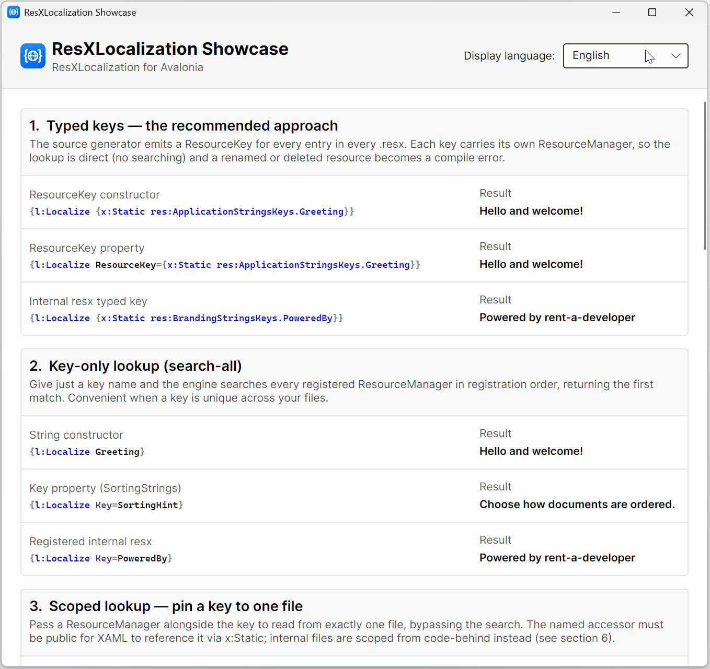

<div align="center">


# ResXLocalization

**Type-safe `.resx` localization for [Avalonia](https://avaloniaui.net/) and [WPF](https://learn.microsoft.com/dotnet/desktop/wpf/) - switch language _live_, no reload, no restart.**

[](https://github.com/rent-a-developer/ResXLocalization/actions/workflows/ci.yml)
[](https://codecov.io/gh/rent-a-developer/ResXLocalization)
[](https://www.nuget.org/packages/ResXLocalization.Avalonia)
[](https://www.nuget.org/packages/ResXLocalization.WPF)
[](https://dotnet.microsoft.com/)
[](https://learn.microsoft.com/dotnet/core/deploying/native-aot/)
[](https://rent-a-developer.github.io/ResXLocalization/)
[](LICENSE.md)

</div>

---

Localizing a XAML app with plain `.resx` usually means string-typed keys that break silently at
runtime, and a language change that only takes effect after a restart or window reload.
ResXLocalization fixes both: you keep the `.resx` files and editors you already use, and get
**compile-checked keys** (a renamed or deleted resource becomes a build error, not a runtime
surprise) and **instant, in-place language switching** - in **Avalonia** and **WPF** alike.

```xml
<!-- Strongly-typed key, generated from your .resx, updates live on every culture switch. -->
<TextBlock Text="{l:Localize {x:Static res:AppStringsKeys.Greeting}}" />
```

```csharp
// Switch the whole UI to German - every bound string re-resolves in place, no reload.
Localizer.Current.CurrentCulture = new CultureInfo("de");
```

<div align="center">
  
  <p><sub>The included sample apps (<a href="samples/ResXLocalization.Avalonia.Sample">Avalonia</a> · <a href="samples/ResXLocalization.WPF.Sample">WPF</a>) - pick a language and every binding updates live, no reload.</sub></p>
</div>

## Highlights

- ⚡ **Live, no-reload language switching** - set one property and every bound string updates in place. No window reload, no view rebuild, no restart.
- 🔒 **Type-safe, compile-checked keys** - a source generator turns every neutral `.resx` into strongly-typed keys with full IntelliSense, with or without a `.Designer.cs`.
- 📦 **Zero configuration** - install one NuGet package and build; typed keys are generated automatically, nothing else to set up.
- 🚀 **Native AOT & trim clean (Avalonia)** - no reflection over your resources; publishes with `PublishAot=true` out of the box. *(WPF is Windows-only and does not support Native AOT.)*
- 🗂️ **First-class multiple `.resx`** - look up by **typed key**, **scope** to one file, or **search across all** registered files in a defined order.
- 🔤 **Enum localization built in** - localize enum members by naming convention, in item templates and as bound values.
- 🧮 **Format arguments on the binding** - in XAML, give `{l:Localize}` and `{l:LocalizeEnum}` `<l:Argument>` children with constant or bound values, so enum labels take arguments too; in code, pass `MessageArguments.FromValues(…)` to `Localizer.Current.Get`.
- 🔢 **ICU MessageFormat, opt-in** - `plural` and `select` messages such as `1 file` / `5 files`, in code and in XAML, with the separate package `ResXLocalization.MessageFormat` - see [ICU MessageFormat](#icu-messageformat-opt-in).
- 🩺 **Lookup-failure diagnostics** - a visible `!key!` failure text (configurable) plus a `LookupFailed` event for logging and coverage reports, for a missing translation and for a value that cannot be formatted.
- 🌐 **Language-picker ready** - `GetAvailableCultures()` discovers the cultures your app actually ships.
- 🧩 **MVVM-friendly** - an injectable `ILocalizer` service with `INotifyPropertyChanged`, markup extensions for XAML, and a clean code-behind API.
- 🪶 **Leak-safe** - discarded controls stay collectable (Avalonia uses weak events; WPF binds to the singleton through WPF's own weak binding-target references).

---

## Requirements

- An app targeting **.NET 8** or later, built with the **.NET 8 SDK or later**.
- For **Avalonia**: **Avalonia 12**. For **WPF**: **Windows**.
- **`.resx`** resource files. A `.Designer.cs` accessor is not required: every neutral `.resx` gets
  typed keys, with or without one - see [Generated keys](docs/reference/generated-keys.md).

## Installation

Install the package for your UI framework:

```shell
# Avalonia
dotnet add package ResXLocalization.Avalonia

# WPF
dotnet add package ResXLocalization.WPF
```

|                | [`ResXLocalization.Avalonia`](https://www.nuget.org/packages/ResXLocalization.Avalonia) | [`ResXLocalization.WPF`](https://www.nuget.org/packages/ResXLocalization.WPF) |
| -------------- | ---------------------------------------------------------------------------------------- | ------------------------------------------------------------------------------ |
| **Targets**    | `net8.0` · `net10.0`                                                                     | `net8.0-windows` · `net10.0-windows`                                           |
| **Platforms**  | cross-platform (Avalonia 12)                                                             | Windows only                                                                   |
| **Native AOT** | ✅ Fully supported                                                                        | ❌ Not supported (WPF limitation)                                               |

That's it - the source generator and the build wiring for your `.resx` files are included; there is
nothing else to configure.

A few project properties are recommended. For **Avalonia** (required if you publish with Native AOT -
see [Native AOT and trimming](docs/guides/native-aot.md)):

```xml
<PropertyGroup>
  <!-- The cultures you ship. Each one builds a satellite assembly; required for AOT. -->
  <SatelliteResourceLanguages>en;de</SatelliteResourceLanguages>

  <!-- Lets the analyzers verify AOT-safety on a normal build. -->
  <IsAotCompatible>true</IsAotCompatible>

  <!-- Recommended for Avalonia apps in general. -->
  <AvaloniaUseCompiledBindingsByDefault>true</AvaloniaUseCompiledBindingsByDefault>
</PropertyGroup>
```

For **WPF**, only the cultures you ship are worth declaring (WPF does not support AOT):

```xml
<PropertyGroup>
  <SatelliteResourceLanguages>en;de</SatelliteResourceLanguages>
</PropertyGroup>
```

## Quick start

### 1. Add your strings

Add a `.resx` file the normal way - for example `Resources/AppStrings.resx` (your neutral/default language) - and a satellite file per culture, e.g. `Resources/AppStrings.de.resx`:

| Key           | `AppStrings.resx` (English) | `AppStrings.de.resx` (German) |
| ------------- | --------------------------- | ----------------------------- |
| `WindowTitle` | `My Application`            | `Meine Anwendung`             |
| `Greeting`    | `Hello and welcome!`        | `Hallo und willkommen!`       |

### 2. Let the generator create typed keys

On every build, the source generator inspects every neutral `.resx` (not the culture satellites such as `AppStrings.de.resx`) and emits a typed key class named `<FileName>Keys`, by default in the namespace of the folder the `.resx` sits in. No `.Designer.cs` is needed. For `AppStrings.resx` you get:

```csharp
// <auto-generated/>
namespace YourApp.Resources;

public static partial class AppStringsKeys
{
    // The resource manager of AppStrings.resx - the one instance every key of this class uses.
    public static ResourceManager ResourceManager { get; } = new("YourApp.Resources.AppStrings", typeof(AppStringsKeys).Assembly);

    public static readonly ResourceKey Greeting    = new("Greeting",    ResourceManager);
    public static readonly ResourceKey WindowTitle = new("WindowTitle", ResourceManager);
    // …one ResourceKey per string entry, sorted, with sanitized member names.
}
```

Each `ResourceKey` carries **both** the key name and the `ResourceManager` it belongs to - that is what makes typed lookups direct and collision-free. Which files qualify, how the namespace is chosen, what becomes a key, and the generator diagnostics are in [Generated keys](docs/reference/generated-keys.md).

### 3. Register your resources at startup

Register each resource file once, then choose the starting culture.

**Avalonia** (`Program.cs`):

```csharp
using System.Globalization;
using RentADeveloper.ResXLocalization;
using YourApp.Resources;

Localizer.Current.RegisterResourceManager(AppStringsKeys.ResourceManager);
Localizer.Current.CurrentCulture = new CultureInfo("en");
```

**WPF** (`App.xaml.cs`):

```csharp
using System.Globalization;
using System.Windows;
using RentADeveloper.ResXLocalization;
using YourApp.Resources;

public partial class App : Application
{
    protected override void OnStartup(StartupEventArgs e)
    {
        base.OnStartup(e);
        Localizer.Current.RegisterResourceManager(AppStringsKeys.ResourceManager);
        Localizer.Current.CurrentCulture = new CultureInfo("en");
    }
}
```

Register the generated `AppStringsKeys.ResourceManager`: it is the instance the typed keys use.
Registration is only needed for **search-all** lookups; typed and scoped lookups need no registration.

> [!TIP]
> In Avalonia, put the registration (and the initial `CurrentCulture`) inside **`BuildAvaloniaApp()`** rather than `Main`. `BuildAvaloniaApp` runs at runtime *and* under the XAML previewer, so search-all lookups like `{l:Localize Greeting}` resolve at design time too instead of showing the `!Greeting!` failure text.

> [!TIP]
> In WPF, the designer does not call `App.OnStartup`, so search-all lookups show the failure text there. Register in a **`[ModuleInitializer]`** of the application assembly instead: it runs at runtime before `Main` *and* in the designer. See [Registering resource files](docs/guides/registration.md#wpf).
>
> ```csharp
> using System.Runtime.CompilerServices;
>
> internal static class ResourceRegistration
> {
>     [ModuleInitializer]
>     internal static void Register()
>     {
>         Localizer.Current.CurrentCulture = new CultureInfo("en");
>         Localizer.Current.RegisterResourceManager(AppStringsKeys.ResourceManager);
>     }
> }
> ```

### 4. Use it in XAML

Add the namespaces and bind with the `{l:Localize}` markup extension.

**Avalonia:**

```xml
<Window xmlns="https://github.com/avaloniaui"
        xmlns:x="http://schemas.microsoft.com/winfx/2006/xaml"
        xmlns:l="clr-namespace:RentADeveloper.ResXLocalization.Avalonia;assembly=ResXLocalization.Avalonia"
        xmlns:res="clr-namespace:YourApp.Resources"
        Title="{l:Localize {x:Static res:AppStringsKeys.WindowTitle}}">

  <TextBlock Text="{l:Localize {x:Static res:AppStringsKeys.Greeting}}" />

</Window>
```

**WPF:**

```xml
<Window xmlns="http://schemas.microsoft.com/winfx/2006/xaml/presentation"
        xmlns:x="http://schemas.microsoft.com/winfx/2006/xaml"
        xmlns:l="clr-namespace:RentADeveloper.ResXLocalization.WPF;assembly=ResXLocalization.WPF"
        xmlns:res="clr-namespace:YourApp.Resources"
        Title="{l:Localize {x:Static res:AppStringsKeys.WindowTitle}}">

  <TextBlock Text="{l:Localize {x:Static res:AppStringsKeys.Greeting}}" />

</Window>
```

- `xmlns:l` points at the **framework package** (Avalonia: `assembly=ResXLocalization.Avalonia`; WPF: `assembly=ResXLocalization.WPF`).
- `xmlns:res` points at the namespace of **your** generated keys / resource accessors.

### 5. Switch language - live

```csharp
Localizer.Current.CurrentCulture = new CultureInfo("de");
```

Every `{l:Localize}` binding re-resolves **immediately**. No reload, no flicker.

## Essential behavior

Three lookup modes, one fallback chain:

```csharp
Localizer.Current.Get(AppStringsKeys.Greeting);                                     // typed - compile-checked, one file
Localizer.Current.Get("Greeting", resourceManager: AppStringsKeys.ResourceManager); // scoped - this key, in this file
Localizer.Current.Get("Greeting");                                                  // search-all - registered files, in order
```

Fallback is .NET's own: a missing `de-DE` entry falls back to `de`, then to the neutral resources. A
key that cannot be resolved anywhere renders the configurable `!key!` failure text and raises
`LookupFailed`. Because fallback runs first, a key that resolves from a parent or neutral
value is not reported as missing.

Enum members are localized by naming convention - one `.resx` entry per member, named
`Enum_<EnumTypeName>_<MemberName>`. Composite-format resources take their arguments in code from
`Localizer.Current.Get(key, MessageArguments.FromValues(…))` - or as named arguments from
`MessageArguments.FromTuples`, `FromDictionary` and `FromObject` - and in XAML from `<l:Argument>`
children of `{l:Localize}` and `{l:LocalizeEnum}`.

For messages whose wording depends on the arguments, such as `1 file` / `5 files`, the opt-in package
`ResXLocalization.MessageFormat` adds ICU MessageFormat - see [ICU MessageFormat](#icu-messageformat-opt-in).

## ICU MessageFormat (opt-in)

`string.Format` cannot change a message's wording by its arguments: `1 file deleted`, but
`5 files deleted`. The opt-in package `ResXLocalization.MessageFormat` formats every localized text as
[ICU MessageFormat](https://unicode-org.github.io/icu/userguide/format_parse/messages/) instead, whose
`plural` and `select` choose the wording by the arguments. Add it next to your UI package:

```shell
dotnet add package ResXLocalization.MessageFormat
```

Then install the ICU formatter once, at startup - in Avalonia in `BuildAvaloniaApp()`, in WPF in
`App.OnStartup` and, for the WPF designer, in the `[ModuleInitializer]` from step 3 of the quick start:

```csharp
using RentADeveloper.ResXLocalization.MessageFormat;

Localizer.Current.UseMessageFormat();
```

Write the resource values in ICU syntax:

| Key            | `AppStrings.resx` (English)                                      | `AppStrings.de.resx` (German)                                        |
| -------------- | ---------------------------------------------------------------- | -------------------------------------------------------------------- |
| `FilesDeleted` | `{Count, plural, one {# file deleted} other {# files deleted}}` | `{Count, plural, one {# Datei gelöscht} other {# Dateien gelöscht}}` |

and pass named arguments - in code with `MessageArguments`, in XAML with named `<l:Argument>` children:

```csharp
Localizer.Current.Get(AppStringsKeys.FilesDeleted, MessageArguments.FromTuples(("Count", 1)));      // "1 file deleted"
Localizer.Current.Get(AppStringsKeys.FilesDeleted, MessageArguments.FromObject(new { Count = 5 })); // "5 files deleted"
```

```xml
<TextBlock>
  <TextBlock.Text>
    <l:Localize Key="{x:Static res:AppStringsKeys.FilesDeleted}">
      <l:Argument Name="Count" Value="{Binding DeletedCount}" />
    </l:Localize>
  </TextBlock.Text>
</TextBlock>
```

`{l:LocalizeEnum}` takes the same `<l:Argument>` children, so an enum label can be a `plural` or
`select` message too. Like the Avalonia package, `ResXLocalization.MessageFormat` is Native AOT and
trim clean.

> [!IMPORTANT]
> After `UseMessageFormat()`, **every** resolved resource value is parsed as an ICU message, also a value
> looked up without arguments: `It''s ready` renders `It's ready`, a literal `{` or `}` is ICU syntax, and
> composite-format spellings such as `{0:N0}` or `{{literal}}` render the failure text and raise
> `Localizer.Current.LookupFailed`. Review your resource values before you opt in -
> [Migrating resource values](docs/guides/message-format.md#migrating-resource-values) shows what to search
> for and how to rewrite it.

Plural categories per language, `select`, how arguments reach ICU, the format culture and number and
date styles are in [ICU MessageFormat](docs/guides/message-format.md).

## Documentation

| Page | What it covers |
| --- | --- |
| [Lookup modes and culture fallback](docs/guides/lookup-and-fallback.md) | Typed, scoped and search-all lookups, registration order, the fallback chain, missing-translation diagnostics, dependency injection, subscription lifetime |
| [Registering resource files](docs/guides/registration.md) | What to register for search-all lookups, where - including the WPF designer and class libraries - dependency injection, resources from other assemblies |
| [Localizing enum values](docs/guides/enums.md) | The naming convention, item templates, `LocalizeEnumConverter`, custom prefixes and scoping |
| [Dynamic format arguments](docs/guides/format-arguments.md) | `Get(key, MessageArguments.FromValues(…))`, the `MessageArguments` factory, and `<l:Argument>` children of `{l:Localize}` with constant or bound values, optionally named |
| [ICU MessageFormat](docs/guides/message-format.md) | The opt-in `ResXLocalization.MessageFormat` package: `plural` and `select` through `Localizer.Current.UseMessageFormat()`, argument mapping, format culture, styles, and migrating resource values to ICU syntax |
| [Design time and previewers](docs/guides/design-time.md) | `DesignTime.Culture` for the preview language, the culture a previewer uses without it, search-all lookups and ICU in the WPF designer, and what to expect in Rider's WPF previewer |
| [Native AOT and trimming](docs/guides/native-aot.md) | What to declare, how to publish, and what a trimming failure looks like |
| [Migrating to 2.0](docs/guides/migration-2.0.md) | Each breaking change of 2.0, with what to do |
| [Generated keys](docs/reference/generated-keys.md) | Which `.resx` files qualify, what becomes a key, the generator diagnostics, the Roslyn floor |
| [API reference](https://rent-a-developer.github.io/ResXLocalization/) | Every public type and member |

## Troubleshooting

**A string shows up as `!key!`.** The key could not be resolved in the current culture's complete
fallback chain. Check that the key exists in the neutral `.resx`, and - for search-all lookups like
`{l:Localize Greeting}` or `{l:LocalizeEnum}` - that the resource manager was registered with
`Localizer.Current.RegisterResourceManager(<Name>Keys.ResourceManager)`. Subscribe to
`Localizer.Current.LookupFailed` to log every miss. See
[Lookup modes and culture fallback](docs/guides/lookup-and-fallback.md).

**No typed `…Keys` class is generated.** Every neutral `.resx` produces a `<FileName>Keys` class,
with or without a `.Designer.cs`; culture satellites such as `AppStrings.de.resx` produce none. A
designer is not required, and there is no `RXLGEN002`. Check the generator warnings: `RXLGEN001`
reports malformed `.resx` XML, `RXLGEN003` a `.resx` whose MSBuild resource name did not reach the
generator, and `RXLGEN004` two neutral `.resx` files that would produce the same keys class - neither
class is generated then. See [Generated keys](docs/reference/generated-keys.md).

**A string does not switch language.** It is probably read through a designer property such as
`AppStrings.Greeting`, in code or as `{x:Static res:AppStrings.Greeting}`. A designer property reads
in `CultureInfo.CurrentUICulture`, which the localizer never changes, so it does not follow
`Localizer.Current.CurrentCulture`. Read the string through a typed key, `Localizer.Current.Get` or
`{l:Localize}` instead. See the warning in
[Lookup modes and culture fallback](docs/guides/lookup-and-fallback.md#registration-is-only-for-search-all).

**A translation is right when you run it and wrong after publishing.** List the cultures you ship in
`SatelliteResourceLanguages`, or the satellite assemblies are not published. See
[Native AOT and trimming](docs/guides/native-aot.md).

**Avalonia version resolution.** The Avalonia package declares 12.0.5 as its minimum so it still
builds under the .NET 8 SDK; applications building with a current SDK resolve Avalonia 12.1 or later
normally.

## The sample applications

Two complete, runnable showcases, one per UI framework - a scrolling window with a live language `ComboBox` and one card each for typed keys, search-all and scoped lookups, enum values in item templates and through `LocalizeEnumConverter`, `<l:Argument>` children, a key bound from the view model, and lookups from code-behind:

```shell
dotnet run --project samples/ResXLocalization.Avalonia.Sample
dotnet run --project samples/ResXLocalization.WPF.Sample   # Windows only
```

The samples use the default formatter; for ICU MessageFormat, see [ICU MessageFormat](#icu-messageformat-opt-in).

## Building from source

You need the **.NET 10 SDK** (see `global.json`); the produced packages target .NET 8 and .NET 10.

```powershell
# Build everything (must be 0 warnings / 0 errors - warnings are promoted to errors).
dotnet build ResXLocalization.slnx -c Release                # Windows (includes WPF)
dotnet build ResXLocalization.NonWindows.slnf -c Release     # Linux/macOS (skips WPF)
```

See [CONTRIBUTING.md](CONTRIBUTING.md) for the gate scripts, the test suites, packing, and the Native AOT check.

## Versioning

This project follows [Semantic Versioning](https://semver.org/). See the [CHANGELOG](CHANGELOG.md) for the history of changes.

## Contributing

Contributions are welcome! Please read [CONTRIBUTING.md](CONTRIBUTING.md) first. In short: open an issue to discuss larger changes, keep the build warning-free, add a `CHANGELOG.md` entry under *Unreleased*, and make sure the tests pass.

## License

Released under the [MIT License](LICENSE.md). © 2026 David Liebeherr.

Thank you Mike James from AvaloniaUI OÜ for the written permission to use `Avalonia` in the name of the `ResXLocalization.Avalonia` NuGet package.

Avalonia is a registered trademark of AvaloniaUI OÜ. This project is not affiliated with or endorsed by AvaloniaUI OÜ.

## Author

**David Liebeherr** - [rent-a-developer](https://github.com/rent-a-developer)
📧 [info@rent-a-developer.de](mailto:info@rent-a-developer.de)

If this library saves you time, a ⭐ on [GitHub](https://github.com/rent-a-developer/ResXLocalization) is appreciated!
